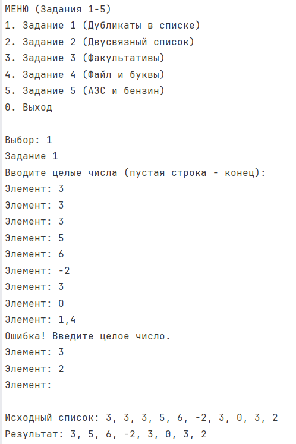
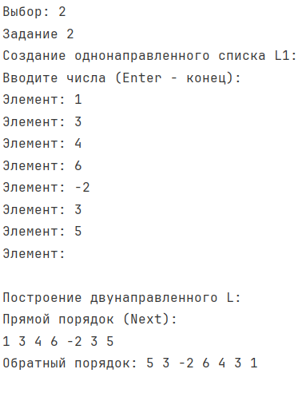
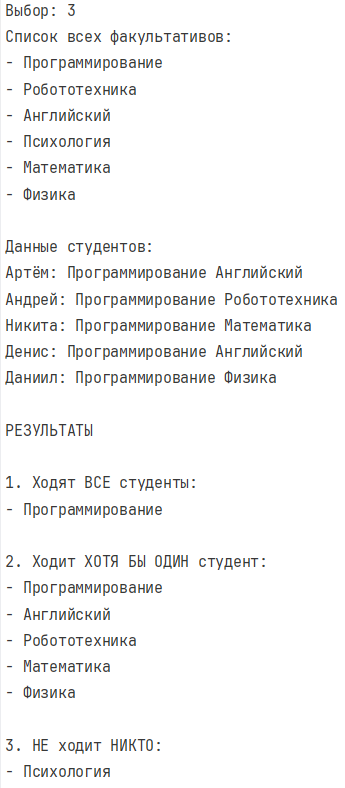
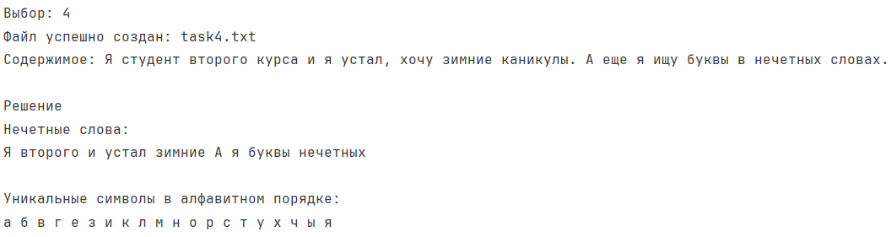
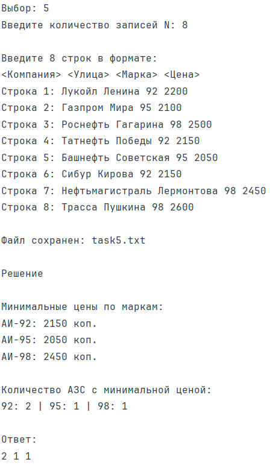
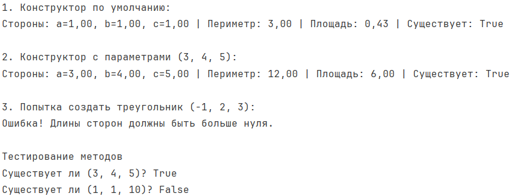
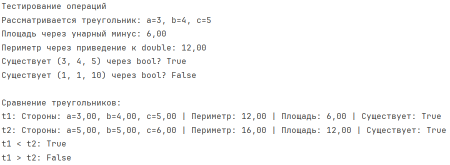

# Лабораторная работа №4
**Салабай Даниил, ИТ-2, Вариант 10**

---

# Задание 1. Удаление подряд идущих дубликатов

## Задача 1
### Текст задачи
Составить программу, которая в списке L из каждой группы подряд идущих одинаковых элементов оставляет только один.

### Алгоритм решения
1. В классе `TasksSolver` создается статический обобщенный метод `RemoveConsecutiveDuplicates<T>(List<T> list)`, принимающий список.
2. Добавляется проверка на `null` (выбрасывается `ArgumentNullException`). Если список пуст, возвращается новый пустой список.
3. Создается результирующий список `result`, в который сразу добавляется первый элемент исходного списка.
4. Запускается цикл со второго элемента (индекс `i = 1`). Внутри цикла текущий элемент сравнивается с предыдущим.
5. Если элементы не равны (с использованием `EqualityComparer<T>.Default`), текущий элемент добавляется в результирующий список.
6. Метод возвращает новый список без подряд идущих дубликатов.

### Тестирование

---

# Задание 2. Двунаправленный список

## Задача 1
### Текст задачи
Построить двунаправленный список L по однонаправленному списку L1.

### Алгоритм решения
1. Создаются вспомогательные обобщенные классы узлов: `Node<T>` (для однонаправленного списка, содержит поля `_data` и `_next`) и `DoubleNode<T>` (для двунаправленного, содержит `_data`, `_next` и `_prev`). Все поля приватные, доступ через свойства.
2. Для создания исходного списка L1 реализован метод `CreateSingleList()`, который запрашивает у пользователя числа с клавиатуры до ввода пустой строки.
3. В методе `BuildDoublyList<T>(Node<T> head)` создается новый головной узел `DoubleNode` на основе первого элемента. 
4. Запускается цикл `while` по узлам однонаправленного списка. Для каждого узла создается новый `DoubleNode`, настраиваются связи: у текущего узла `Next` указывает на новый, а у нового `Prev` указывает на текущий.
5. Для доказательства двунаправленности реализован метод `PrintDoublyListReverse()`, который сначала доходит до хвоста списка, а затем выводит элементы в обратном порядке, используя свойство `Prev`.

### Тестирование

---

# Задание 3. Множества (Факультативы)

## Задача 1
### Текст задачи
Есть перечень факультативов. Студенты группы записались на некоторые из них. Определить:
1. На какие факультативы ходят все студенты.
2. На какие ходит хотя бы один студент.
3. На какие не ходит никто.

### Алгоритм решения
1. Используется структура `HashSet<string>` для хранения математических множеств.
2. Создается множество `allElectives` со всеми доступными факультативами.
3. Для тестирования создаются 5 студентов (множества `student1` ... `student5`), данные захардкожены для проверки всех ситуаций.
4. Для поиска тех, кто ходит **хотя бы один**, создается пустое множество `unionElectives`, к которому последовательно применяется метод `UnionWith` для каждого студента.
5. Для поиска тех, куда ходят **все**, создается копия `intersectElectives` от `allElectives`, к которой последовательно применяется метод `IntersectWith`. 
6. Для поиска тех, куда **не ходит никто**, создается копия `noneElectives`, из которой методом `ExceptWith` вычитается `unionElectives`.
7. Результаты выводятся на экран.

### Тестирование

---

# Задание 4. Текстовый файл (буквы в нечетных словах)

## Задача 1
### Текст задачи
Файл содержит текст на русском языке. Напечатать в алфавитном порядке символы, которые встречаются хотя бы один раз в словах с нечётными номерами (нумерацию вести с 1).

### Алгоритм решения
1. Реализован метод `CreateTask4File`, который создает файл с русским текстом с помощью `File.WriteAllText`.
2. Метод `SolveTask4` проверяет наличие файла (`File.Exists`), после чего считывает текст.
3. Строка разбивается на массив слов с помощью `Split` (разделители — пробелы и знаки препинания).
4. Запускается цикл по всем словам. Если номер слова нечетный (`wordIndex % 2 != 0`), слово приводится к нижнему регистру. Внутренний цикл перебирает все символы слова. Если символ является русской буквой, он добавляется в `HashSet<char>`. Множество автоматически отсеивает дубликаты.
5. После сбора всех букв, `HashSet` копируется в массив, который сортируется с помощью `Array.Sort`.
6. Отсортированный массив выводится на экран.

### Тестирование

---

# Задание 5. АЗС и стоимость бензина (Файлы и Dictionary)

## Задача 1
### Текст задачи
Определить для каждого вида бензина (92, 95, 98), сколько АЗС продают его дешевле всего. Формат ввода: в первой строке `N`, затем `N` строк с данными о заправках. Исходные данные хранятся в файле.

### Алгоритм решения
1. Метод `FillTask5FileFromConsole` запрашивает у пользователя количество записей `N` и сами строки (Компания, Улица, Марка, Цена), после чего сохраняет их в текстовый файл (первая строка — `N`).
2. Метод `SolveTask5` проверяет файл на существование. Считываются все строки.
3. Создается объект `Dictionary<string, int>` для хранения минимальных цен. Строки разбиваются, и для каждой марки бензина ищется минимальная цена (если марки нет в словаре — добавляется, если есть — сравнивается с текущей минимальной).
4. Создается второй `Dictionary` для подсчета количества АЗС. Проход по файлу повторяется, и если цена заправки равна минимальной цене для этой марки, счетчик в словаре увеличивается.
5. Выводится результат в формате: количество для 92, 95 и 98 через пробел. Если бензин не найден, выводится `0`.

### Тестирование

---

# Задание 6. Класс Triangle (ООП)

## Задача 1
### Текст задачи
Реализовать класс `Triangle`. Поля: длины сторон (double). Определить, существует ли треугольник с такими длинами (результат bool). Перегрузить `ToString()`.

### Алгоритм решения
1. В отдельном проекте создается класс `Triangle`. Поля `_a`, `_b`, `_c` приватные.
2. Создаются конструкторы: по умолчанию (стороны 1, 1, 1) и с параметрами. В конструкторе с параметрами и в сеттерах свойств стоит защита: если сторона `<= 0`, выбрасывается `ArgumentException`.
3. Метод `IsValid()` проверяет неравенство треугольника (сумма любых двух сторон должна быть строго больше третьей).
4. Метод `GetArea()` вычисляет площадь по формуле Герона. Если треугольник не существует, возвращает `0`.
5. Метод `GetPerimeter()` возвращает сумму сторон.
6. Переопределен метод `ToString()` для вывода сторон, периметра, площади и факта существования.

### Тестирование

---

# Задание 7. Перегрузка операций (Triangle)

## Задача 1
### Текст задачи
Добавить к классу `Triangle` перегрузку операций: унарный минус (площадь), приведение типов (double — периметр, bool — существует ли), бинарные `<` и `>` (сравнение площадей).

### Алгоритм решения
1. Перегружается унарный оператор `-` (принимает `Triangle`, возвращает `double`). Внутри вызывается метод `GetArea()`.
2. Реализуется неявное приведение типов `implicit operator double(Triangle t)`, которое возвращает `GetPerimeter()`.
3. Реализуется явное приведение `explicit operator bool(Triangle t)`, которое возвращает результат метода `IsValid()`.
4. Перегружаются бинарные операторы `<` и `>` (принимают два `Triangle`). Внутри происходит сравнение площадей, полученных через `GetArea()`.
5. В методе `Main` тестируются все операции с выводом результатов на экран.

### Тестирование

